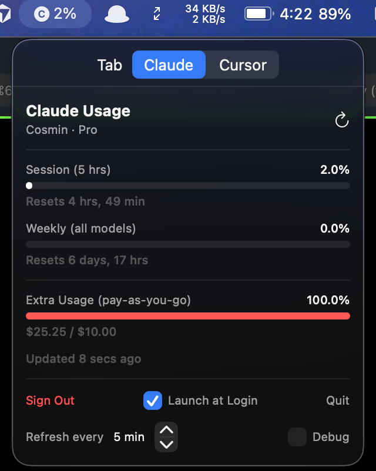
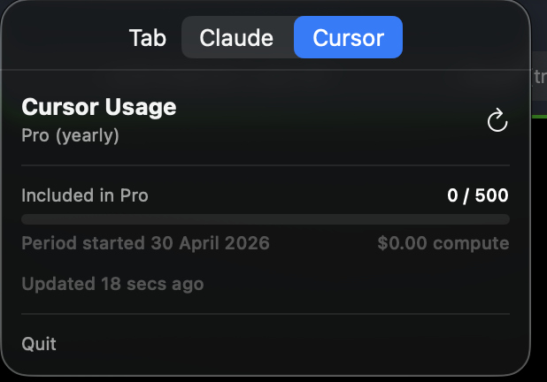

# CajuAI

A lightweight macOS menu bar app that displays your [Anthropic Claude](https://claude.ai) and [Cursor](https://cursor.com) usage in real time.

## Screenshots

## Features

### Claude
- Session (5-hour) and weekly usage progress bars, colour-coded by utilisation
- Sonnet-specific weekly usage tracking
- Extra/pay-as-you-go usage with credit amounts
- OAuth 2.0 + PKCE authentication with CSRF state validation (no API key required)
- Tokens stored securely in the macOS Keychain
- Automatic token refresh
- Configurable refresh interval (1–60 min)
- Launch at login toggle
- Debug stats panel (total API calls, successes, errors)

### Cursor
- Fast request usage vs. plan limit (Pro: 500/month, Free: 50/month)
- Per-model request breakdown
- Billing period start date and total compute cost
- No extra sign-in — reads your existing Cursor session

### General
- No Dock icon — lives entirely in the menu bar
- Auto-refreshes on popover open (at most once per minute)

## Requirements

- macOS 26.3 or later
- An Anthropic Claude Pro or Max subscription
- [Cursor](https://cursor.com) installed and signed in (for the Cursor tab)

## Installation

1. Clone the repo and open `CajuAI.xcodeproj` in Xcode
2. In the **CajuAI** target:
   - **Signing & Capabilities** → App Sandbox → enable **Outgoing Connections (Client)**
   - **Info** tab → add `Application is agent (UIElement)` = `YES`
3. Build and run (Cmd+R), or archive for a release build
4. Copy `CajuAI.app` from the Products folder to `/Applications`

## Sign In (Claude)

1. Click the menu bar icon and press **Sign In with Claude**
2. Complete authentication in your browser
3. Copy the full redirect URL from the address bar (`https://console.anthropic.com/oauth/code/callback?code=…`)
4. Paste it back into the app and press **Continue**

The Cursor tab works automatically — no sign-in needed.

## Usage

The menu bar icon shows your current Claude session utilisation percentage. Click it to see the full breakdown across both tabs.

| Colour | Meaning |
|--------|---------|
| White  | < 40% used |
| Yellow | 40–69% used |
| Red    | ≥ 70% used |

Use the **Launch at Login** checkbox to start the app automatically on login.

## Credits

OAuth flow based on [hass-claude-usage](https://github.com/trickv/hass-claude-usage) by trickv.

## License

MIT
